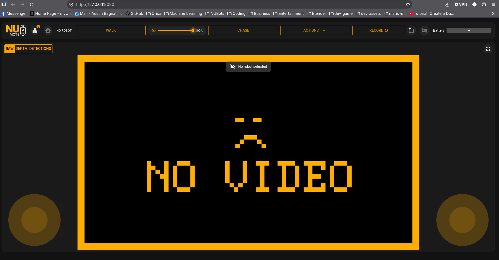
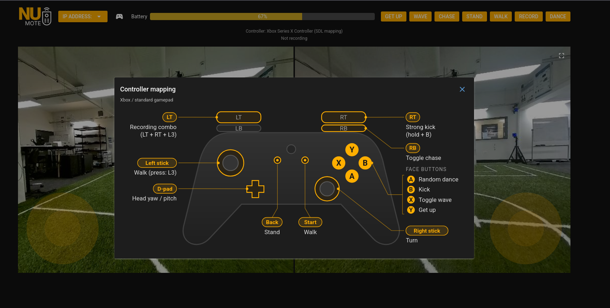

# NUmote

A browser remote for Booster K1 robots: live cameras, driving from on-screen sticks or a gamepad, robot actions and video recording.

## Requirements

- Python 3.11 or newer
- `ssh`, `scp` and `ffmpeg`, with key-based SSH access to the robot
- The epsilon-x wifi network, so robots can be discovered

## Install

`scripts/numote.sh` creates `.venv` and installs `requirements.txt` on first run, and again when they change.

## Run

`scripts/numote.sh` (picks a free port if 8080 is taken), then open http://localhost:8080

Set `NUMOTE_WEB_PORT` to change the port. 

( RECOMMENDED ) `scripts/numote.sh --install-launcher` adds an applications menu entry.

Note: use `lsof -i :<NUMOTE_WEB_PORT>` to return the PIDs running on that port then use `kill -9 <PID>` to terminate zombie processes.

## Using the viewer

- **Network icon:** pick a robot.
- **Robot icon:** connection status, and a refresh button to update the bridge on the robot.
- **Controller icon:** shows the controller mapping.
- **Header:** WALK, speed slider, CHASE, ACTIONS and RECORD.

## Controller layout

| Input | Action |
| --- | --- |
| Left stick | Walk (L3 press is used in the record combo) |
| Right stick | Turn |
| D-pad | Head yaw / pitch |
| A | Random dance |
| B | Kick |
| X | Toggle wave |
| Y | Get up |
| RB | Toggle chase |
| Back | Stand |
| Start | Walk |
| LT + A | Random soccer celebration |
| RT + A | Danger dance |
| RT + B | Power kick |
| LT, then RT, then L3 | Start / stop recording |

Nintendo Switch controllers have the same actions: ZL/ZR/L/R are LT/RT/LB/RB, Minus/Plus are Back/Start, and face buttons follow the printed label, so A/B and X/Y sit in swapped positions.
